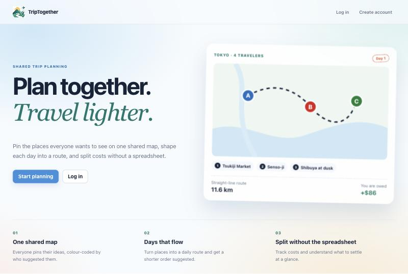
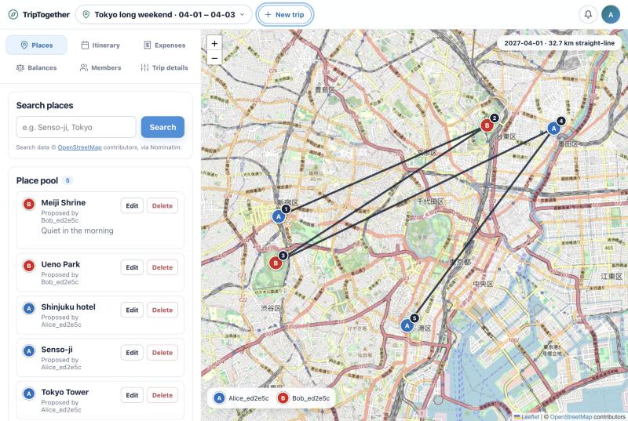
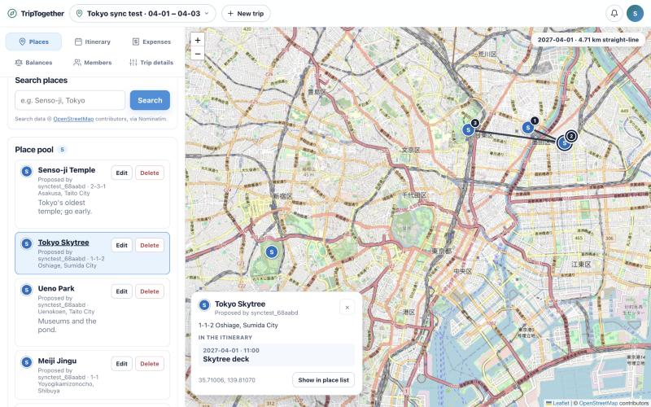
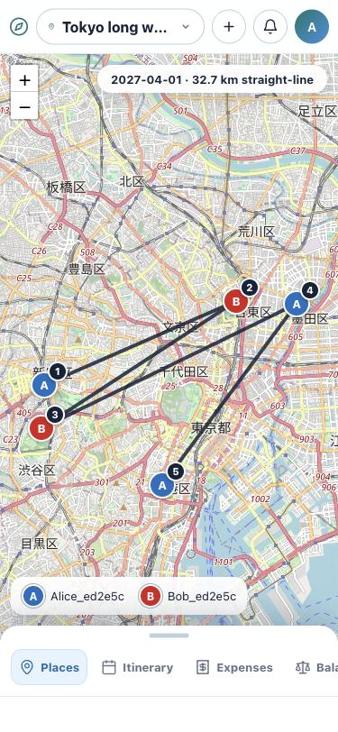
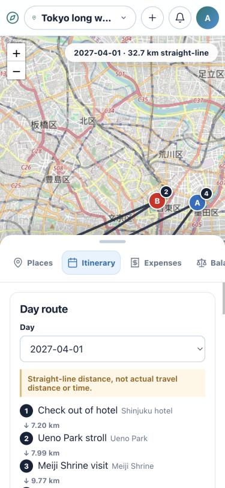

# TripTogether

> A collaborative travel planning web application for shared itineraries, group expenses, and settlement tracking.

TripTogether is a full-stack collaborative travel-planning application for small groups. It keeps a trip's people, itinerary, shared expenses, balances, and settlement suggestions in one workspace.

## Overview

This is a deployed portfolio MVP. The application deliberately keeps the domain small: plan together, travel together, and settle fairly.

**Live Demo:** [TripTogether](https://trip-together-zeta.vercel.app) · [API health](https://triptogether-api.onrender.com/health)

## Features

- Register and log in with JWT authentication.
- Create, edit, delete, and join trips through invitations.
- Maintain a shared, date-grouped itinerary with create, edit, delete, and reorder actions (drag and drop or arrow buttons).
- Record exact-decimal expenses with equal splits.
- View server-derived balances and suggested settlement transfers.
- Use responsive pages with loading, empty, error, confirmation, and success feedback.
- Plan on a shared map: search or pin candidate places (colour-coded per member), link them to itinerary items, view each day's straight-line route, and apply a suggested shorter visiting order with conflict detection.
- Select a place in the lists or on the map: both sides highlight it, and a floating card shows its details and the itinerary items it belongs to.
- See the straight-line distance between consecutive stops right in the itinerary list, with the day's total beside its date.
- The map frames the selected day's stops, with a one-click switch to show every place.
- Open Expenses to see your own position first: what you owe or are owed, what you paid, your share, and your suggested transfers.

## Tech Stack

**Frontend:** React, TypeScript, Vite, React Router, Leaflet, dnd-kit, Vitest, Testing Library, ESLint.

**Backend:** FastAPI, SQLAlchemy, PostgreSQL, Alembic, pytest, httpx.

**Authentication:** JWT and Argon2id password hashing.

**Deployment:** Vercel (frontend), Render (FastAPI), and Render PostgreSQL.

## Architecture

```text
React SPA → REST API → FastAPI → Service Layer → SQLAlchemy → PostgreSQL
```

The browser renders backend-provided exact monetary strings; it never recomputes equal splits or balances.

## Core Workflow

Create Trip → Invite Members → Shared Itinerary → Track Expenses → Calculate Balances → Settlement Suggestions

## Local Development

Requirements: Python 3.9+, Node 24 LTS, npm, and a running PostgreSQL instance.

```bash
python3 -m venv .venv
source .venv/bin/activate
python -m pip install -r backend/requirements.txt
cp -n .env.example .env
cd backend
python -m alembic upgrade head
CORS_ORIGINS='["http://127.0.0.1:5173","http://localhost:5173"]' python -m uvicorn app.main:app --reload
```

In a second terminal:

```bash
cd frontend
npm ci
cp -n .env.example .env
npm run dev -- --host 127.0.0.1 --port 5173 --strictPort
```

Open `http://127.0.0.1:5173`.

## Environment Variables

The root `.env` configures the server: `DATABASE_URL`, `JWT_SECRET_KEY`, `JWT_ALGORITHM`, `ACCESS_TOKEN_EXPIRE_MINUTES`, `APP_ENV`, `CORS_ORIGINS`, and the optional `GEOCODER_*` place-search settings. Use a strong local JWT key and never commit it.

`frontend/.env.example` contains only `VITE_API_BASE_URL`. All `VITE_*` values are bundled for the browser and are public configuration. Do not put database URLs, passwords, or JWT signing secrets there.

## Deployment

TripTogether is deployed with a static frontend build, a non-reloading FastAPI process, and hosted PostgreSQL. The browser calls the backend's public HTTPS origin; the backend connects to PostgreSQL through its private connection string. The project owner confirmed production registration after migration to `0005 (head)`; the collaborative-map release requires `0007 (head)` and PostgreSQL 15+ (see the [schema release procedure](docs/step20-production-deployment.md#releasing-a-schema-change-render-free--auto-deploy)).

```text
Browser → static frontend → public HTTPS API → hosted PostgreSQL
```

Development uses `npm run dev`, `uvicorn --reload`, and a local PostgreSQL instance. Production uses `npm run build`, a static web server, `uvicorn app.main:app --host 0.0.0.0 --port "$PORT"` without `--reload`, and hosted PostgreSQL. A production frontend must be rebuilt whenever `VITE_API_BASE_URL` changes because Vite embeds it in the generated browser bundle.

### Production Environment Variables

| Variable | Used by | Production requirement |
| --- | --- | --- |
| `DATABASE_URL` | Backend | PostgreSQL `postgresql+psycopg://...` URL supplied by the host/provider. |
| `JWT_SECRET_KEY` | Backend | Unique secret of at least 32 bytes; never use the example placeholder. |
| `JWT_ALGORITHM` | Backend | `HS256`. |
| `ACCESS_TOKEN_EXPIRE_MINUTES` | Backend | Integer between 1 and 1440; current project variable name. |
| `APP_ENV` | Backend | `production`, which validates database and JWT configuration on startup. |
| `CORS_ORIGINS` | Backend | JSON array of exact HTTPS frontend origins, with no trailing slash. |
| `GEOCODER_PROVIDER` | Backend | `disabled` (default) or `nominatim`; `fake` is rejected in production. Set `disabled` and restart to turn search off. |
| `GEOCODER_USER_AGENT` | Backend | Required for `nominatim`: application name plus contact, per the [Nominatim usage policy](https://operations.osmfoundation.org/policies/nominatim/). |
| `GEOCODER_BASE_URL` | Backend | HTTPS origin; defaults to the public Nominatim service. |
| `VITE_API_BASE_URL` | Frontend build | Public HTTPS backend origin only; it is safe to expose but must not contain credentials. |
| `VITE_MAP_TILE_URL` | Frontend build | Optional HTTPS tile template. The default public OSM tiles are for development and light demos only; use a commercial or self-hosted tile service for real traffic. |
| `VITE_MAP_TILE_ATTRIBUTION` | Frontend build | Required with a custom `VITE_MAP_TILE_URL`: the provider's credit as plain text (HTML is escaped). Without it the map falls back to OSM tiles and credit. |

Keep these values in the deployment platform's secret/configuration store. `.env` is local-only and ignored by Git; `.env.example` and `frontend/.env.example` contain placeholders only.

### Migration and Startup Strategy

Run `alembic upgrade head` once as a controlled release step for a new database
or schema update, before validating business traffic. Do not let every backend
replica run migrations on boot. On a Render plan with a Pre-Deploy Command, use
it as one controlled migration step. Render Free has no Pre-Deploy Command, so
run the migration manually from a trusted environment with the Render database
URL supplied as an environment variable. Verify `alembic current` reports
`0007 (head)` for this release. Never put the URL in a committed file or shell
history. After migration succeeds, start the API without reload:

```bash
cd backend
APP_ENV=production python -m alembic upgrade head
APP_ENV=production /path/to/venv/bin/python -m uvicorn app.main:app --host 0.0.0.0 --port "${PORT:-8000}"
```

`/health` is a liveness endpoint and never accesses the database. `/ready`
validates JWT configuration, PostgreSQL connectivity, that the database
revision matches the application's single Alembic head, and that all nine
core tables exist. It returns 503 until every check passes; use it for
readiness checks after the controlled migration finishes.

### CORS

Never use a wildcard origin for production. Configure the exact deployed frontend URL, for example:

```bash
CORS_ORIGINS='["https://app.example.com"]'
```

The backend rejects non-HTTPS origins when `APP_ENV=production`. The Docker Compose simulator below runs on HTTP localhost, so it intentionally defaults to `APP_ENV=development` while still using non-reloading production processes. Set `APP_ENV=production` only behind HTTPS with HTTPS origins.

### Docker

Docker files use the repository root as the build context so `.dockerignore` excludes local secrets, dependencies, build output, caches, and AppleDouble metadata. The backend image does not copy `.env` and starts Uvicorn without reload. The frontend image uses a Node build stage and serves `dist` with Nginx, including SPA route fallback.

For a local production-process simulation, copy the examples and set only local placeholder-free values:

```bash
cp -n .env.example .env
# In .env set a strong JWT_SECRET_KEY, a URL-safe POSTGRES_PASSWORD,
# CORS_ORIGINS='["http://127.0.0.1:5173"]', APP_ENV=development,
# and VITE_API_BASE_URL=http://127.0.0.1:8000.
docker compose up --build
```

Compose starts `postgres`, runs the one-shot `migrate` job, then starts `backend` and `frontend`. Open `http://127.0.0.1:5173`; the frontend reaches the host-exposed backend at `http://127.0.0.1:8000`. Stop the simulator with `docker compose down`; add `-v` only when deliberately deleting its local database volume.

### Local Production Simulation Without Docker

With a migrated local PostgreSQL database, build the frontend with an explicit API URL and start both production processes without reload:

```bash
cd frontend
VITE_API_BASE_URL=http://127.0.0.1:8000 npm run build
npm run preview -- --host 127.0.0.1 --port 4173 --strictPort

# Separate terminal
cd backend
APP_ENV=development CORS_ORIGINS='["http://127.0.0.1:4173"]' \
  /path/to/venv/bin/python -m uvicorn app.main:app --host 127.0.0.1 --port 8000
```

Verify `/health`, `/ready`, registration, login, trip creation, invitations, itinerary changes, expenses, balances, and settlement suggestions. Use the existing PostgreSQL verification scripts for disposable end-to-end test data.

### Platform Configuration: Vercel + Render

The frontend runs on Vercel with `frontend` as the Root Directory,
Node `24.x`, `npm run build`, and `dist` as the Output Directory.
`frontend/vercel.json` rewrites all paths to `index.html`, preserving direct
React Router access to `/login`, `/register`, `/trips`, `/account`, and
`/trips/:id`.

The backend runs on a Render Python Web Service with `backend` as the
Root Directory, build command `pip install -r requirements.txt`, start command
`uvicorn app.main:app --host 0.0.0.0 --port $PORT`, and HTTP health check
`/ready`. Use Render Postgres's internal connection URL when both services are
in the same region. Standard provider `postgres://` and `postgresql://` URLs
are normalized to the project's `postgresql+psycopg` driver at the config
boundary; local development URLs continue to work unchanged.

Render's Free Postgres tier is useful for a short-lived prototype, but it
expires after 30 days and has no backups. A paid Render Postgres plan is the
recommended persistent portfolio choice. Neon Postgres is a simple lower-cost
prototype alternative after reviewing its current plan limits. See the
[deployment checklist](docs/deployment-checklist.md) for the exact manual
sequence, secret handling, migration procedure, CORS sequence, and smoke test.
The complete Step 20A handoff, including the Render/Vercel fields and
troubleshooting flow, is in the [production deployment runbook](docs/step20-production-deployment.md).

## Testing

```bash
# frontend
cd frontend
npm test
npm run lint
npm run typecheck
npm run build

# backend
cd ../backend
python -m pytest -q
RUN_POSTGRES_TESTS=1 python -m pytest -q

# opt-in real PostgreSQL / FastAPI checks from repository root
python frontend/scripts/verify_auth.py
python frontend/scripts/verify_trips.py
python frontend/scripts/verify_collaboration.py
python frontend/scripts/verify_finance.py
```

GitHub Actions runs the backend suite, including its PostgreSQL integration
tests against a disposable PostgreSQL service, and runs the frontend tests,
lint, typecheck, and production build. CI uses no production credentials.

The verification scripts create random disposable users and clean them up. They require a migrated PostgreSQL database; they never substitute SQLite.

## Known Limitations

- No OAuth, refresh tokens, payments, booking, chat, or live updates.
- Logout clears the local token; server-side revocation is not implemented.
- Backend authorization remains the source of truth; hidden browser controls are UX only.

See [known limitations](docs/known-limitations.md) and the [Step 17 learning review](docs/step17-review.md).

## Frontend Experience

After signing in, **the trip map is the home screen**. A slim top bar holds a
trip switcher (a dropdown of every trip you own or joined), *New trip*, an
invitations bell with a pending count, and the account menu. Every feature
sits in a sidebar beside the full-height map: Places, Itinerary (day route and
suggested order), Expenses, Balances, Members, and Trip details. The open panel
is kept in the URL (`/trips/12?panel=itinerary`), and `/trips` reopens the last
trip you viewed. On phones the sidebar becomes a bottom sheet over the map
(peek, half or full height).

The lists and the map share one selection. Clicking a place in the place pool,
or the linked place of an itinerary item, pans the map to it and rings its
marker together with its stop on the day route. Clicking a marker highlights
its row in the place pool and scrolls it into view, and hovering either side
highlights the other. A floating card on the map shows the selected place's
address, note, coordinates and linked itinerary items, with a shortcut back to
the place list; Esc, the close button or a click on empty map closes it. On
phones, selecting a place lowers the sheet so the card and marker stay visible.

The itinerary list also shows the map's route day: between consecutive stops it
shows the straight-line hop (for example "↓ 1.82 km"), naming the starting stop
when an item without a place sits in between, and the day's total sits beside
its date. Any other day has a *Show distances* link that makes it the route day
on the map and in the list.

Items are reordered within a day by dragging the grip on the left of a row
(dnd-kit, with keyboard support); the up and down arrows remain. The new order
shows as soon as the row is dropped, and is saved through the same guarded
reorder request: if saving fails the row moves back, and if another member
changed the day first the latest order is reloaded instead of retrying.

The map frames the route day's stops rather than every place in the pool, so a
day's route fills the view. A chip in the top-right corner reads like
"2027-04-01 · 3 stops · 4.71 km straight-line", next to a *Show all places*
button that zooms out to the whole pool (it becomes *Focus on this day*).
Switching days refocuses the map; a day without located stops frames every
place.

The Expenses panel opens with a summary of the signed-in member's position: a
headline card reading *You owe*, *You're owed* or *You're all square*, smaller
cards for *You paid* and *Your share*, the suggested transfers that involve
you ("Pay friend 17.75 USD"), and a link to everyone's balances. It reloads
after every expense change. Like the rest of the app, it shows the server's
exact amounts and does no money arithmetic in the browser, which is also why
there is no trip-total card.

Public pages use a travel palette (sky, sea, sand and sunset) over a softly
"breathing" gradient backdrop: an 18-second drift of colour that stops when the
system asks for reduced motion. The workspace, including Leaflet, is a lazily
loaded chunk, so the landing and sign-in pages stay light.

Accessibility carries over from earlier steps: tabbed panels with arrow-key,
Home and End navigation, named and focusable map markers, member colours that
always come with an initial and a name, semantic status and alert roles, and
in-page confirmations instead of browser dialogs.

## Screenshots

Captured from a local build with demo data.

### Landing page



### Map workspace



### Place details on the map



### On a phone

| Map with the sheet collapsed | Itinerary panel in the bottom sheet |
| --- | --- |
|  |  |

## Future Improvements

Future work may include rate limiting, token revocation, observability, real-browser accessibility testing, and CI. These are outside this hardening task.
