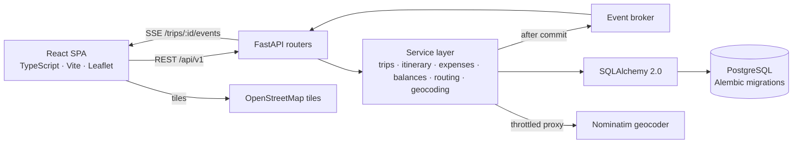

# TripTogether

[](https://github.com/zh315-bit/TripTogether/actions/workflows/ci.yml)
[](https://trip-together-zeta.vercel.app)
[](https://triptogether-api.onrender.com/health)

**Plan together, travel together, settle fairly.**
A full-stack web app where a small group plans a trip on a shared map, keeps one itinerary, records expenses, and gets exact settlement suggestions.

**Live demo:** <https://trip-together-zeta.vercel.app> · **API health:** <https://triptogether-api.onrender.com/health>


## Highlights

- **Map-first collaboration.** Members search or pin candidate places (colour-coded per person), link them to itinerary items, and see each day's route with stop-to-stop distances. A route optimiser (nearest neighbour + 2-opt, seeded from every start) proposes a shorter visiting order and detects conflicts before applying it.
- **Money you can trust.** Amounts are `Numeric(12, 2)` end to end. Equal splits are computed once on the server with a deterministic remainder rule; the browser renders exact decimal strings and never does money arithmetic.
- **Live collaboration.** Every committed change is pushed to the other members over Server-Sent Events; their lists refresh in place with a one-line notice ("Jonas changed an itinerary item"). Events are staged inside the transaction and published only after commit, so a client never refetches a change that rolled back. A dropped stream reconnects with backoff and triggers a full resync.
- **Concurrency by design.** Writes serialise on the parent trip row (`SELECT … FOR UPDATE`), and every editable row carries a version: clients echo it in `If-Match`, and a stale edit gets a 412 with the newer version shown instead of a silent overwrite. Dedicated concurrency tests cover itinerary, membership, expenses and balances.
- **Shared rate limiting for an external API.** Place search proxies Nominatim behind a single database-backed throttle row, so the one-request-per-second policy holds across every worker and instance.
- **Production-shaped from day one.** `/ready` checks JWT config, database connectivity, the Alembic head and all core tables. Migrations are a controlled release step, not a boot side effect. CORS rejects non-HTTPS origins in production.
- **Tested at every layer.** 280+ backend tests (unit, contract, migration, PostgreSQL integration, query-count audits, a live SSE stream under concurrent writes) and 180+ frontend tests (Vitest + Testing Library), all run in CI with a real PostgreSQL service.

## Features

| Area | What you can do |
| --- | --- |
| Trips & members | Register (Argon2id), sign in (JWT), create trips, invite registered users, accept or reject invitations |
| Itinerary | Date-grouped items with create, edit, delete and drag-and-drop reorder (dnd-kit, keyboard accessible) |
| Map | Search or pin places, add a pool place to any day in one click, link them to items, select from list or map with two-way highlight, frame the selected day, apply a suggested shorter order |
| Expenses | Exact-decimal expenses with equal splits, per-member summary ("You owe", "You paid", "Your share") |
| Balances | Server-derived balances and suggested transfers to settle the trip |
| Live updates | Other members' changes appear within a second, with a notice saying who did what; conflicting edits are detected and never overwrite each other |
| UX | Responsive map workspace (sidebar on desktop, bottom sheet on phones), loading/empty/error states, in-page confirmations |

## Architecture



- **Routers** validate input with Pydantic and map domain errors to a uniform JSON error contract.
- **Services** own all business rules: authorisation checks, split arithmetic, balance aggregation, route optimisation and the geocoder throttle. Routers never touch the ORM directly. Services stage change events on the session; a SQLAlchemy `after_commit` hook hands them to the broker, and `after_rollback` discards them.
- **Models and migrations** are versioned with Alembic (seven revisions); readiness fails until the database matches the application's single head.
- **Frontend** keeps a centralised API client and auth context, typed contracts mirroring the backend schemas, and a lazily loaded workspace chunk so public pages stay light.

Detailed references: [API inventory](docs/api-inventory.md) · [Authorization matrix](docs/authorization-matrix.md) · [Client integration guide](docs/client-integration.md)

## Tech Stack

| Layer | Choices |
| --- | --- |
| Frontend | React 19, TypeScript, Vite, React Router 7, Leaflet, dnd-kit, Vitest, Testing Library, ESLint |
| Backend | Python, FastAPI, Pydantic v2, SQLAlchemy 2.0, Alembic, psycopg 3, httpx, pytest |
| Auth | JWT (PyJWT) with Argon2id password hashing |
| Infra | PostgreSQL 15+, Docker Compose, GitHub Actions, Vercel (SPA), Render (API), Neon (database) |

## Screenshots

| Day route with distances | Optimiser preview |
| --- | --- |
|  |  |

| Live update from another member | Stale edit refused, newer version loaded |
| --- | --- |
|  |  |

| Place detail card | Conflict detected before applying |
| --- | --- |
|  |  |

<details>
<summary>More: landing page and phone layout</summary>


| Map with the sheet collapsed | Itinerary in the bottom sheet | Optimiser on a phone |
| --- | --- | --- |
|  |  |  |

</details>

## Quick Start

Requirements: Python 3.9+, Node 24, npm, and a running PostgreSQL instance.

```bash
# backend
python3 -m venv .venv && source .venv/bin/activate
python -m pip install -r backend/requirements.txt
cp -n .env.example .env            # set DATABASE_URL and a strong JWT_SECRET_KEY
cd backend
python -m alembic upgrade head
CORS_ORIGINS='["http://127.0.0.1:5173","http://localhost:5173"]' python -m uvicorn app.main:app --reload
```

```bash
# frontend, in a second terminal
cd frontend
npm ci
cp -n .env.example .env            # VITE_API_BASE_URL=http://127.0.0.1:8000
npm run dev -- --host 127.0.0.1 --port 5173 --strictPort
```

Open <http://127.0.0.1:5173>. Interactive API docs are at <http://127.0.0.1:8000/docs>.

**Docker Compose** runs the same stack as non-reloading production processes (PostgreSQL, a one-shot migration job, the API, and the built SPA behind Nginx):

```bash
cp -n .env.example .env   # fill in JWT_SECRET_KEY and POSTGRES_PASSWORD
docker compose up --build
```

## Testing

```bash
cd backend && python -m pytest -q                        # unit + contract + migration tests
cd backend && RUN_POSTGRES_TESTS=1 python -m pytest -q   # plus PostgreSQL integration tests
cd frontend && npm test && npm run lint && npm run typecheck && npm run build
```

CI ([ci.yml](.github/workflows/ci.yml)) runs both suites on every push and pull request, with the backend tests against a disposable PostgreSQL 16 service. The scripts in `frontend/scripts/verify_*.py` exercise the real API end to end with disposable users.

## Engineering Notes

A few decisions worth knowing about:

- **Why the server owns every number.** Floating-point money and client-side split logic are the classic source of "the balances don't add up". The backend stores `Decimal`, splits with a deterministic remainder (ascending user id), and returns strings; the UI only displays them.
- **Why both a trip-level lock and per-row versions.** The lock keeps the database invariants (one split per member, contiguous day order) simple to prove: writes to one trip never interleave. But a lock cannot know that a user started editing from a stale screen, so each editable row also carries a version. The client sends it as `If-Match`; a mismatch is a 412 and the UI shows the newer version instead of overwriting it. Omitting the header keeps the old last-write-wins behaviour for simple clients.
- **Why Server-Sent Events rather than WebSocket.** The traffic is one way: the server only needs to say "something changed". SSE over `fetch` reuses the Bearer header, the CORS policy and the JSON error envelope of every other route, needs no extra dependency, and reconnects trivially. The client refetches the affected list rather than applying diffs, so the screen is always the server's committed state.
- **Why events are published after commit.** Services stage events on the SQLAlchemy session; an `after_commit` hook publishes them and `after_rollback` drops them. A subscriber that refetches on an event therefore always sees the row that triggered it. The broker is in-process (one API instance); scaling out means putting PostgreSQL `LISTEN/NOTIFY` or Redis behind the same publish/subscribe interface.
- **Why the throttle lives in PostgreSQL.** Nominatim's usage policy is one request per second per application, not per process. A single `geocoder_throttle` row locked on each request enforces that across workers; an upstream 403/429 starts a shared cooldown.
- **Why Leaflet is wrapped directly.** `react-leaflet` 5 is licensed under Hippocratic 2.1 (not OSI-approved), so the app wraps Leaflet (BSD-2-Clause) in a small `LeafletMap` component.
- **Why straight-line distances.** The optimiser needs a metric that works without a routing provider. Great-circle distance is honest about being an approximation; the UI labels it "straight-line" everywhere.

## Deployment

The SPA is a static Vercel build, the API is a Render web service started with plain `uvicorn` (no reload), and the database is hosted PostgreSQL. Secrets live only in the platform's configuration store; `.env` is local-only.

```text
Browser → Vercel (static SPA) → Render (FastAPI) → Neon PostgreSQL
```

The step-by-step runbook, environment variable matrix, schema release procedure and smoke test are in [docs/production-deployment.md](docs/production-deployment.md) and the [deployment checklist](docs/deployment-checklist.md).

## Known Limitations and Roadmap

This is a deliberately small, deployed MVP. The main gaps, all documented in [docs/known-limitations.md](docs/known-limitations.md):

- Live updates fan out inside one API instance; running several instances needs a shared channel behind the broker. Clients that omit `If-Match` still get last-write-wins.
- Equal splits only, one currency per trip, no refresh tokens or password reset, unpaginated lists.
- Public OSM tiles and Nominatim are for demos; real traffic needs a commercial or self-hosted provider.

Planned next: weighted splits with a minimum-transfer settlement, Playwright end-to-end tests in CI, and PostgreSQL `LISTEN/NOTIFY` so live updates survive scaling out.
