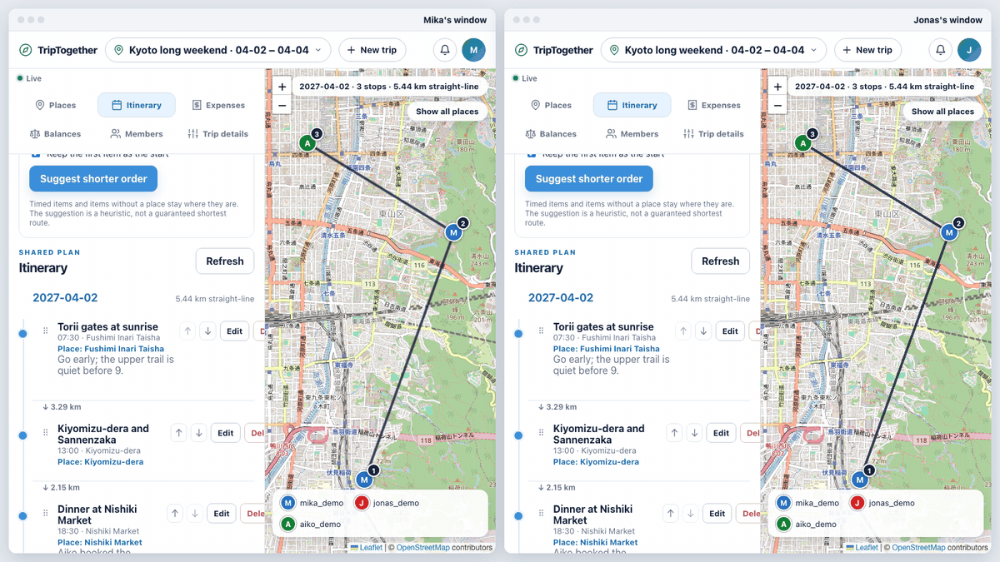
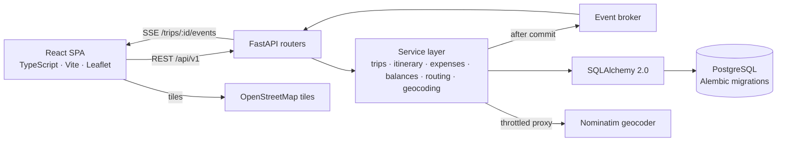
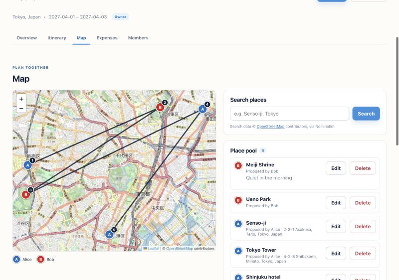
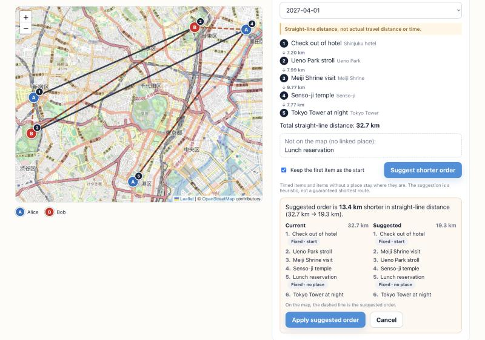
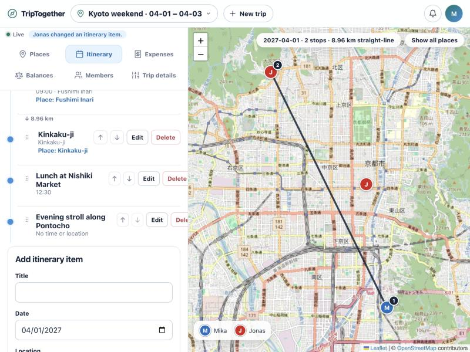
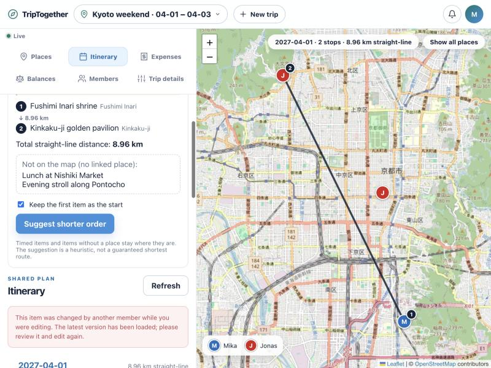
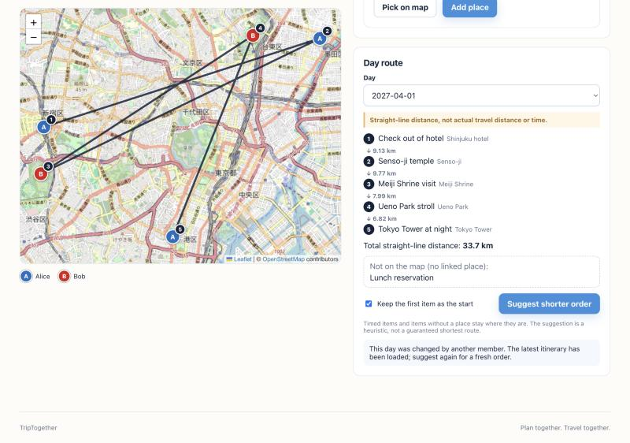
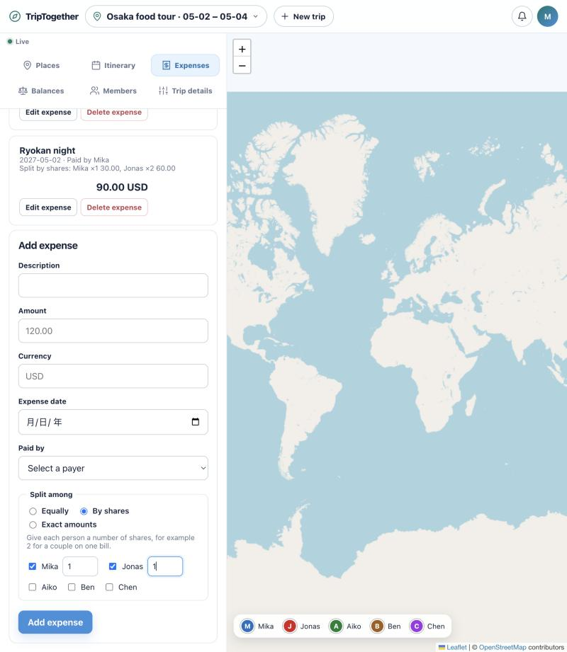
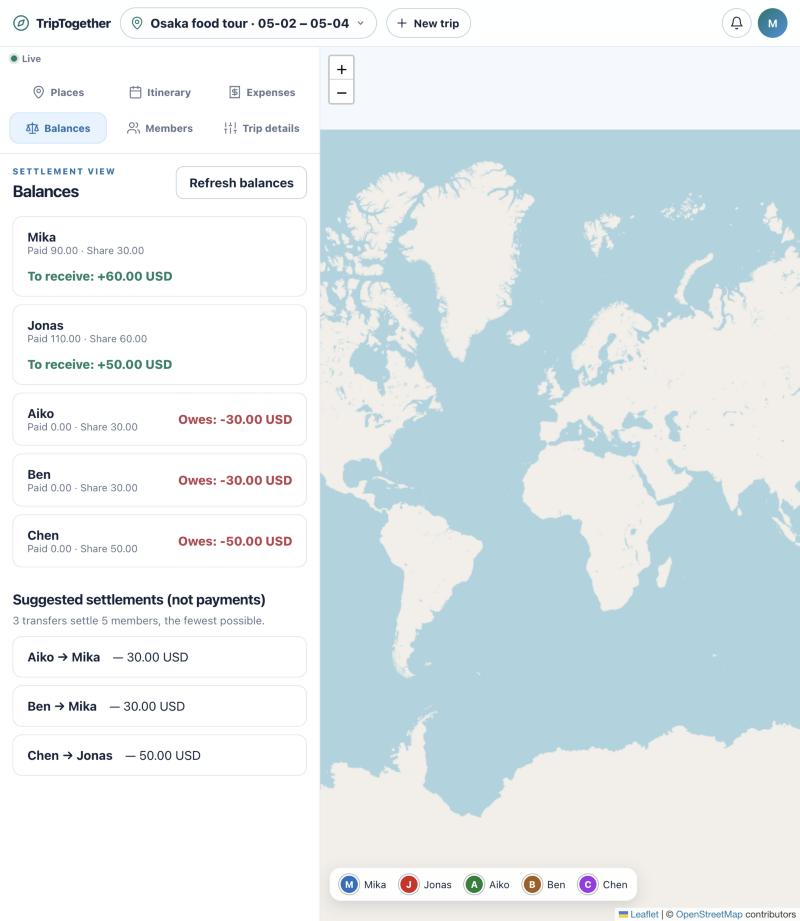
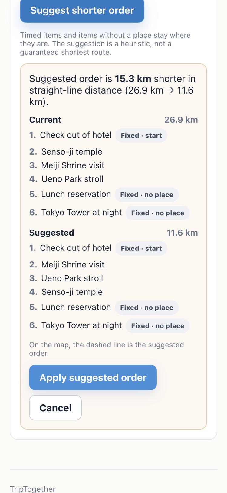

# TripTogether

[](https://github.com/zh315-bit/TripTogether/actions/workflows/ci.yml)
[](https://trip-together-zeta.vercel.app)
[](https://triptogether-api.onrender.com/health)
[](https://github.com/zh315-bit/TripTogether/actions/workflows/codeql.yml)
[](https://github.com/zh315-bit/TripTogether/releases)

**Plan together, travel together, settle fairly.**
A full-stack web app where a small group plans a trip on a shared map, keeps one itinerary, records expenses, and gets exact settlement suggestions.

**Live demo:** <https://trip-together-zeta.vercel.app> · **API health:** <https://triptogether-api.onrender.com/health>



**Try it in 10 seconds:** press **Try the demo** on the landing page. It signs you in as Mika on a seeded Kyoto trip (three members, five places, a routed itinerary, expenses split three ways). Use **Open as Jonas** in the sidebar to open a second window and watch an edit in one appear in the other. The demo trip rebuilds itself every six hours.


## Highlights

- **Map-first collaboration.** Members search or pin candidate places (colour-coded per person), link them to itinerary items, and see each day's route with stop-to-stop distances. A route optimiser (nearest neighbour + 2-opt, seeded from every start) proposes a shorter visiting order and detects conflicts before applying it.
- **Money you can trust.** Amounts are `Numeric(12, 2)` end to end. An expense is split equally, by shares (weights) or by exact amounts; the server apportions cents with the largest-remainder method and a deterministic tie-break, and the browser renders exact decimal strings without doing money arithmetic.
- **Fewest transfers to settle.** Balances are partitioned into the most zero-sum groups by a bitmask dynamic programme (exact up to 14 members in debt or credit), and each group settles with a greedy pairing: five members who would need four payments get three, and the response says whether the plan is provably minimal.
- **Live collaboration.** Every committed change is pushed to the other members over Server-Sent Events; their lists refresh in place with a one-line notice ("Jonas changed an itinerary item"). Events are staged inside the transaction and published only after commit, so a client never refetches a change that rolled back. A dropped stream reconnects with backoff and triggers a full resync. With `REALTIME_BACKEND=postgres` the events travel as `pg_notify` inside the writing transaction and a relay on every instance feeds them to its own streams, so live updates survive scaling out.
- **Concurrency by design.** Writes serialise on the parent trip row (`SELECT … FOR UPDATE`), and every editable row carries a version: clients echo it in `If-Match`, and a stale edit gets a 412 with the newer version shown instead of a silent overwrite. Dedicated concurrency tests cover itinerary, membership, expenses and balances.
- **Shared rate limiting for an external API.** Place search proxies Nominatim behind a single database-backed throttle row, so the one-request-per-second policy holds across every worker and instance.
- **Production-shaped from day one.** `/ready` checks JWT config, database connectivity, the Alembic head and all core tables. Migrations are a controlled release step, not a boot side effect. CORS rejects non-HTTPS origins in production. Sessions use short-lived JWTs plus rotating, single-use refresh tokens with replay detection, and password reset works through single-use mailed links. Login, registration and reset are rate limited per client with a PostgreSQL-backed window that holds across instances; every response carries an `X-Request-ID` that is also on each JSON log line, and list routes page with `limit`/`offset` plus `X-Total-Count`.
- **Tested at every layer.** 300+ backend tests (unit, contract, migration, PostgreSQL integration, query-count audits, a live SSE stream under concurrent writes, settlement plans checked against brute force) 180+ frontend tests (Vitest + Testing Library), and Playwright end-to-end tests that drive two real browsers through the live-collaboration and settlement flows, all run in CI with a real PostgreSQL service.

## Features

| Area | What you can do |
| --- | --- |
| Trips & members | Register (Argon2id), sign in (JWT), create trips, invite registered users, accept or reject invitations |
| Itinerary | Date-grouped items with create, edit, delete and drag-and-drop reorder (dnd-kit, keyboard accessible) |
| Map | Search or pin places, add a pool place to any day in one click, link them to items, select from list or map with two-way highlight, frame the selected day, apply a suggested shorter order |
| Expenses | Exact-decimal expenses split equally, by shares or by exact amounts (with an "adds up" check), per-member summary ("You owe", "You paid", "Your share") |
| Balances | Server-derived balances and the fewest transfers that settle the trip, labelled as minimal or greedy; mark a transfer as paid and the balances and suggestions update for everyone |
| Live updates | Other members' changes appear within a second, with a notice saying who did what; conflicting edits are detected and never overwrite each other |
| UX | Responsive map workspace (sidebar on desktop, bottom sheet on phones), loading/empty/error states, in-page confirmations |

## Architecture



- **Routers** validate input with Pydantic and map domain errors to a uniform JSON error contract.
- **Services** own all business rules: authorisation checks, split arithmetic, balance aggregation, route optimisation and the geocoder throttle. Routers never touch the ORM directly. Services stage change events on the session; a SQLAlchemy `after_commit` hook hands them to the broker, and `after_rollback` discards them.
- **Models and migrations** are versioned with Alembic (seven revisions); readiness fails until the database matches the application's single head.
- **Frontend** keeps a centralised API client and auth context, typed contracts mirroring the backend schemas, and a lazily loaded workspace chunk so public pages stay light.

Detailed references: [API inventory](docs/api-inventory.md) · [Authorization matrix](docs/authorization-matrix.md) · [Client integration guide](docs/client-integration.md)

## Tech Stack

| Layer | Choices |
| --- | --- |
| Frontend | React 19, TypeScript, Vite, React Router 7, Leaflet, dnd-kit, Vitest, Testing Library, ESLint |
| Backend | Python, FastAPI, Pydantic v2, SQLAlchemy 2.0, Alembic, psycopg 3, httpx, pytest |
| Auth | JWT (PyJWT) with Argon2id password hashing |
| Infra | PostgreSQL 15+, Docker Compose, GitHub Actions, Vercel (SPA), Render (API), Neon (database) |

## Screenshots

| Day route with distances | Optimiser preview |
| --- | --- |
|  |  |

| Live update from another member | Stale edit refused, newer version loaded |
| --- | --- |
|  |  |

| Place detail card | Conflict detected before applying |
| --- | --- |
|  |  |

| Split by shares | Fewest transfers |
| --- | --- |
|  |  |

<details>
<summary>More: landing page and phone layout</summary>


| Map with the sheet collapsed | Itinerary in the bottom sheet | Optimiser on a phone |
| --- | --- | --- |
|  |  |  |

</details>

## Quick Start

Requirements: Python 3.9+, Node 24, npm, and a running PostgreSQL instance.

```bash
# backend
python3 -m venv .venv && source .venv/bin/activate
python -m pip install -r backend/requirements.txt
cp -n .env.example .env            # set DATABASE_URL and a strong JWT_SECRET_KEY
cd backend
python -m alembic upgrade head
CORS_ORIGINS='["http://127.0.0.1:5173","http://localhost:5173"]' python -m uvicorn app.main:app --reload
```

```bash
# frontend, in a second terminal
cd frontend
npm ci
cp -n .env.example .env            # VITE_API_BASE_URL=http://127.0.0.1:8000
npm run dev -- --host 127.0.0.1 --port 5173 --strictPort
```

Open <http://127.0.0.1:5173>. Interactive API docs are at <http://127.0.0.1:8000/docs>.

**Docker Compose** runs the same stack as non-reloading production processes (PostgreSQL, a one-shot migration job, the API, and the built SPA behind Nginx):

```bash
cp -n .env.example .env   # fill in JWT_SECRET_KEY and POSTGRES_PASSWORD
docker compose up --build
```

## Testing

```bash
cd backend && python -m pytest -q                        # unit + contract + migration tests
cd backend && RUN_POSTGRES_TESTS=1 python -m pytest -q   # plus PostgreSQL integration tests
cd frontend && npm test && npm run lint && npm run typecheck && npm run build
cd frontend && npm run e2e                               # Playwright against the real stack
```

The end-to-end suite ([frontend/e2e](frontend/e2e)) starts a migrated backend on port 8011 and the Vite dev server on 5175 by itself, then drives two real browsers through registration, trip creation and invitations, a live itinerary update with the stale-edit refusal, and a shares split settled with the fewest transfers. It needs `DATABASE_URL` and `JWT_SECRET_KEY`, from the environment or the repository `.env`, and `E2E_PYTHON` if your interpreter is not on the path as `python`.

CI ([ci.yml](.github/workflows/ci.yml)) runs all three suites on every push and pull request: backend and frontend first, then the Playwright job against its own PostgreSQL 16 service, uploading the HTML report on failure. The scripts in `frontend/scripts/verify_*.py` exercise the real API end to end with disposable users.

## Engineering Notes

A few decisions worth knowing about:

- **Why the server owns every number.** Floating-point money and client-side split logic are the classic source of "the balances don't add up". The backend stores `Decimal`, apportions shares with the largest-remainder method (floor every proportional share, then hand the leftover cents to the largest fractional remainders, ties to the lowest user id), and returns strings; the UI only displays them. Exact splits are accepted only when they add up to the amount, and the form says how much is still unassigned before it sends anything.
- **Why settlement is a partition problem.** Any group of k members whose balances sum to zero can settle in k − 1 transfers, so the fewest transfers overall means the most zero-sum groups. The service runs an O(2ⁿ·n) subset DP over members with a nonzero balance (exact up to 14 of them, greedy beyond, and the response says which) and pairs largest debt with largest credit inside each group. The DP is checked against a brute-force partition search in tests.
- **Why both a trip-level lock and per-row versions.** The lock keeps the database invariants (one split per member, contiguous day order) simple to prove: writes to one trip never interleave. But a lock cannot know that a user started editing from a stale screen, so each editable row also carries a version. The client sends it as `If-Match`; a mismatch is a 412 and the UI shows the newer version instead of overwriting it. Omitting the header keeps the old last-write-wins behaviour for simple clients.
- **Why Server-Sent Events rather than WebSocket.** The traffic is one way: the server only needs to say "something changed". SSE over `fetch` reuses the Bearer header, the CORS policy and the JSON error envelope of every other route, needs no extra dependency, and reconnects trivially. The client refetches the affected list rather than applying diffs, so the screen is always the server's committed state.
- **Why the rate limiter lives in PostgreSQL.** An in-memory counter resets on every deploy and splits across workers, so a brute-force attempt gets N chances instead of one. One upsert per request (`INSERT … ON CONFLICT DO UPDATE … RETURNING`) starts or extends a fixed window atomically, with no race between read and write and no extra service. Only the unauthenticated routes are limited; everything else is behind a Bearer token.
- **Why events are published after commit.** Services stage events on the SQLAlchemy session; an `after_commit` hook publishes them and `after_rollback` drops them. A subscriber that refetches on an event therefore always sees the row that triggered it.
- **Why LISTEN/NOTIFY rather than Redis for scaling out.** The `postgres` backend sends each staged event as `pg_notify` from a `before_commit` hook, inside the writing transaction: PostgreSQL delivers it to every instance's relay only when that transaction commits, which gives cross-instance delivery the same "never a rolled-back change" guarantee for free, with no new service. The relay reconnects with backoff and tells its subscribers to resync, since notifications sent while it was away are not replayed. It is opt-in because a permanent LISTEN connection keeps a serverless database awake.
- **Why the throttle lives in PostgreSQL.** Nominatim's usage policy is one request per second per application, not per process. A single `geocoder_throttle` row locked on each request enforces that across workers; an upstream 403/429 starts a shared cooldown.
- **Why Leaflet is wrapped directly.** `react-leaflet` 5 is licensed under Hippocratic 2.1 (not OSI-approved), so the app wraps Leaflet (BSD-2-Clause) in a small `LeafletMap` component.
- **Why straight-line distances.** The optimiser needs a metric that works without a routing provider. Great-circle distance is honest about being an approximation; the UI labels it "straight-line" everywhere.

## Deployment

The SPA is a static Vercel build, the API is a Render web service started with plain `uvicorn` (no reload), and the database is hosted PostgreSQL. Secrets live only in the platform's configuration store; `.env` is local-only.

```text
Browser → Vercel (static SPA) → Render (FastAPI) → Neon PostgreSQL
```

The step-by-step runbook, environment variable matrix, schema release procedure and smoke test are in [docs/production-deployment.md](docs/production-deployment.md) and the [deployment checklist](docs/deployment-checklist.md).

## Known Limitations and Roadmap

This is a deliberately small, deployed MVP. The main gaps, all documented in [docs/known-limitations.md](docs/known-limitations.md):

- Live updates fan out inside one API instance by default; `REALTIME_BACKEND=postgres` relays them through LISTEN/NOTIFY for several instances, at the cost of one always-open database connection per instance. Clients that omit `If-Match` still get last-write-wins.
- One currency per trip, no percentages (use shares); sessions end with the browser tab (no "remember me" cookie).
- Public OSM tiles and Nominatim are for demos; real traffic needs a commercial or self-hosted provider.

Planned next: paging in the web client once trips outgrow one screen, a "remember me" cookie session, and multi-currency ledgers.
